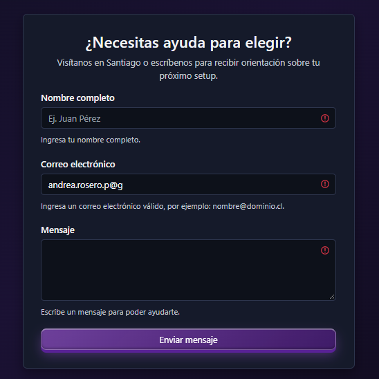
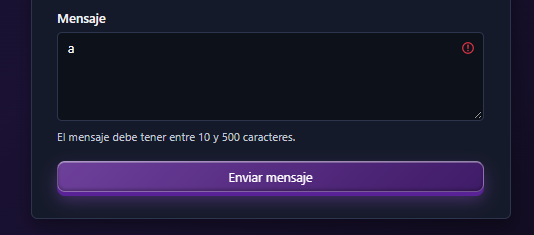
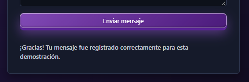
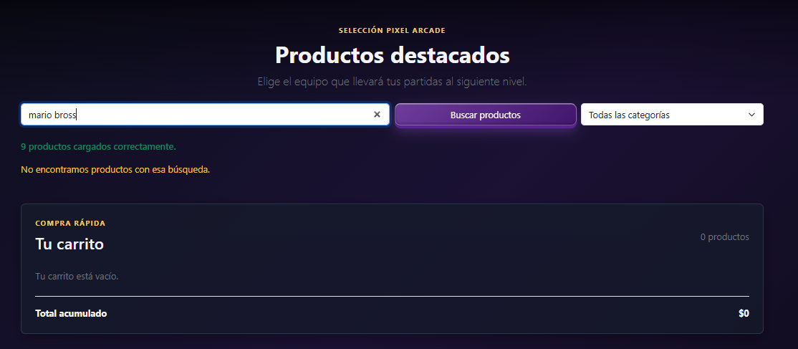
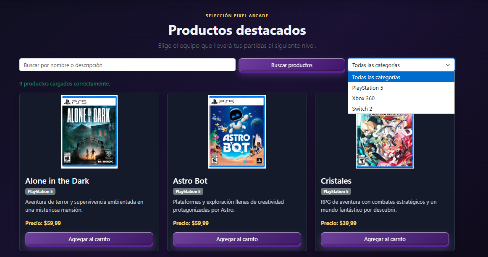
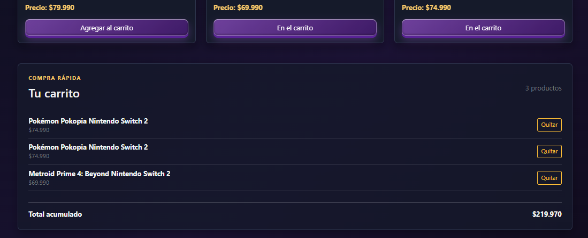

# Pixel Arcade

## Presentación del proyecto

Pixel Arcade es una tienda web de videojuegos desarrollada como resultado de la evolución del trabajo realizado durante el bimestre. El proyecto comenzó como una interfaz de productos y fue incorporando progresivamente nuevos recursos de desarrollo frontend con React, hasta convertirse en un catálogo interactivo con filtros, carrito de compras y formulario de contacto.

Durante el bimestre se trabajó con:

- Componentes reutilizables en React.
- Separación de la interfaz en componentes `Navbar`, `HeroCarousel`, `ContactForm` y `Footer`.
- Props para comunicar información y eventos entre componentes.
- `useState` para administrar estados de la interfaz.
- Renderizado dinámico de productos mediante `.map()`.
- Renderizado condicional para estados vacíos, resultados de búsqueda y mensajes.
- Filtrado de productos por categoría.
- Búsqueda de videojuegos por nombre y descripción.
- Validaciones personalizadas de formularios.
- Manejo de mensajes de error, envío y confirmación.
- Diseño responsive con Bootstrap 5.
- Maquetación semántica con HTML5.
- Estilos personalizados con CSS y uso de Flexbox.
- Organización modular de una aplicación React con Vite.

El formulario de contacto utiliza actualmente un envío simulado para demostrar el flujo de validación y confirmación. No envía datos a un correo ni requiere un backend.

## Funcionalidades

### Catálogo de videojuegos

El catálogo contiene nueve videojuegos distribuidos en tres categorías:

- PlayStation 5.
- Xbox 360.
- Switch 2.

Cada tarjeta de producto presenta:

- Imagen.
- Nombre.
- Categoría.
- Descripción.
- Precio.
- Botón para agregar al carrito.

Los datos se encuentran en [`src/assets/products.js`](./src/assets/products.js) y las imágenes se almacenan en [`src/assets/img/`](./src/assets/img/).

### Filtro y búsqueda

La aplicación incluye:

- Menú desplegable para filtrar por categoría.
- Opción para mostrar todas las categorías.
- Búsqueda por nombre o descripción.
- Combinación del filtro por categoría con la búsqueda textual.
- Mensaje cuando no existen coincidencias.

### Carrito de compras

El carrito permite:

- Agregar productos.
- Agregar varias unidades del mismo videojuego.
- Mostrar la cantidad total en la barra de navegación.
- Eliminar productos individualmente.
- Mostrar un mensaje cuando está vacío.
- Calcular el total acumulado.
- Mostrar `Precio no disponible` si en el futuro se agrega un producto sin valor.

### Formulario de contacto

El formulario está implementado como un componente reutilizable en [`src/components/ContactForm.jsx`](./src/components/ContactForm.jsx).

Incluye:

- Estado React para nombre, correo y mensaje.
- Validación de nombre obligatorio.
- Validación de longitud del nombre entre 2 y 80 caracteres.
- Validación de caracteres permitidos en el nombre.
- Validación del formato del correo electrónico.
- Validación de mensaje entre 10 y 500 caracteres.
- Mensajes específicos debajo de cada campo.
- Indicadores visuales de campos inválidos.
- Estado de envío.
- Mensaje de confirmación exitoso.
- Mensaje de error cuando la validación no es correcta.
- Envío simulado sin backend.

El uso de `event.preventDefault()` permite que React controle la validación y la simulación del envío sin recargar la página.

### Modularidad de la interfaz

La estructura de la interfaz se divide en componentes reutilizables:

- [`Navbar.jsx`](./src/components/Navbar.jsx): navegación principal y contador del carrito mediante props.
- [`HeroCarousel.jsx`](./src/components/HeroCarousel.jsx): carrusel promocional independiente.
- [`ShoppingCart.jsx`](./src/components/ShoppingCart.jsx): búsqueda, filtro, tarjetas y carrito.
- [`ContactForm.jsx`](./src/components/ContactForm.jsx): formulario con estado y validaciones.
- [`Footer.jsx`](./src/components/Footer.jsx): pie de página reutilizable.
- [`App.jsx`](./src/App.jsx): composición general y estado del contador del carrito.

Esta separación mantiene en `App.jsx` únicamente la composición de la página y la comunicación entre las secciones principales, facilitando el mantenimiento y la reutilización.

## Ejemplos de código para la exposición

Los siguientes fragmentos corresponden a la implementación actual y sirven para explicar las decisiones principales del proyecto.

### 1. HTML semántico y conexión entre secciones

La aplicación utiliza elementos semánticos para separar la navegación, el contenido principal, el catálogo, el carrito, el contacto y el pie de página. Los enlaces de la barra de navegación apuntan a los `id` de las secciones:

```jsx
<header>
  <nav aria-label="Navegación principal">
    <a href="#inicio">Inicio</a>
    <a href="#productos">Productos</a>
    <a href="#carrito">Carrito</a>
    <a href="#contacto">Contacto</a>
  </nav>
</header>

<main id="inicio">
  <section id="productos" aria-labelledby="products-title">
    <h2 id="products-title">Productos destacados</h2>
  </section>

  <aside id="carrito" aria-labelledby="cart-title">
    <h2 id="cart-title">Tu carrito</h2>
  </aside>

  <section id="contacto" aria-labelledby="contact-title">
    <h2 id="contact-title">¿Necesitas ayuda para elegir?</h2>
  </section>
</main>

<footer>Pixel Arcade</footer>
```

Esta estructura mejora la accesibilidad y permite que la navegación interna funcione sin cambiar de página.

### 2. Objeto JavaScript con los videojuegos

El archivo [`products.js`](./src/assets/products.js) exporta un arreglo de objetos. Cada objeto contiene la información necesaria para representar una tarjeta:

```js
export const products = [
  {
    id: 1,
    name: "Alone in the Dark",
    image: aloneInTheDarkImage,
    alt: "Portada de Alone in the Dark",
    category: "PlayStation 5",
    description: "Aventura de terror y supervivencia.",
    price: 59.99,
  },
  {
    id: 4,
    name: "Plantas vs. Zombies: Garden Warfare",
    image: plantsVsZombiesImage,
    alt: "Portada de Plantas vs. Zombies: Garden Warfare",
    category: "Xbox 360",
    description: "Batallas multijugador entre plantas y zombis.",
    price: 29000,
  },
];
```

El arreglo completo contiene nueve videojuegos y tres categorías: `PlayStation 5`, `Xbox 360` y `Switch 2`. Las imágenes se importan como módulos locales para que Vite las incluya correctamente en la compilación.

### 3. Renderizado dinámico de las tarjetas

En [`ProductList.jsx`](./src/components/ProductList.jsx), `.map()` genera una tarjeta por cada videojuego filtrado. Así no es necesario escribir nueve tarjetas manualmente:

```jsx
{filteredProducts.map((product) => (
  <div className="col-12 col-md-6 col-lg-4" key={product.id}>
    <article className="card product-card h-100">
      
      <div className="card-body d-flex flex-column">
        <h3 className="card-title">{product.name}</h3>
        <span className="badge text-bg-secondary">
          {product.category}
        </span>
        <p className="card-text">{product.description}</p>
        <p className="fw-bold">Precio: {formatPrice(product.price)}</p>
        <button onClick={() => onAddToCart(product)}>
          {cart.some((item) => item.id === product.id)
            ? "En el carrito"
            : "Agregar al carrito"}
        </button>
      </div>
    </article>
  </div>
))}
```

El `key` permite que React identifique cada elemento, mientras que las expresiones `{product.name}`, `{product.price}` y `{product.category}` insertan información dinámica.

### 4. Búsqueda y filtrado por categoría

El filtrado no es únicamente una búsqueda textual. La aplicación compara la propiedad `category` del objeto con la opción seleccionada en el menú:

```jsx
const filteredProducts = products.filter((product) =>
  `${product.name} ${product.description}`
    .toLowerCase()
    .includes(searchTerm.toLowerCase()) &&
  (selectedCategory === "Todas" ||
    product.category === selectedCategory),
);
```

Las categorías se generan a partir de los datos disponibles y el `select` actualiza el estado cuando el usuario cambia de opción:

```jsx
const categories = [
  ...new Set(products.map((product) => product.category)),
];

<select
  value={selectedCategory}
  onChange={(event) => setSelectedCategory(event.target.value)}
>
  <option value="Todas">Todas las categorías</option>
  {categories.map((category) => (
    <option key={category} value={category}>
      {category}
    </option>
  ))}
</select>
```

### 5. `state` para agregar y eliminar productos

En [`ShoppingCart.jsx`](./src/components/ShoppingCart.jsx), el catálogo llega como prop, mientras que el contenido del carrito se administra con estado. Esto permite agregar varias unidades y eliminarlas individualmente sin modificar el arreglo original:

```jsx
const [cart, setCart] = useState([]);

const addToCart = (product) => {
  const uniqueId = `${product.id}-${Date.now()}-${Math.random()}`;
  const nextCart = [...cart, { ...product, uniqueId }];
  setCart(nextCart);
  onCountChange(nextCart.length);
};

const removeFromCart = (uniqueId) => {
  const nextCart = cart.filter(
    (product) => product.uniqueId !== uniqueId,
  );
  setCart(nextCart);
  onCountChange(nextCart.length);
};
```

También se usan estados independientes para controlar el texto de búsqueda y la categoría seleccionada:

```jsx
const [searchTerm, setSearchTerm] = useState("");
const [selectedCategory, setSelectedCategory] = useState("Todas");
```

Por lo tanto, los productos disponibles se mantienen en `products`, y las acciones dinámicas de agregar o quitar videojuegos se reflejan en `cart`.

### 6. `props` para comunicar componentes

[`App.jsx`](./src/App.jsx) importa el catálogo y lo entrega a `ShoppingCart`. También pasa una función para que el componente hijo informe al componente principal la cantidad actual del carrito:

```jsx
const [cartCount, setCartCount] = useState(0);

<Navbar cartCount={cartCount} />

<ShoppingCart
  products={catalog}
  onCountChange={setCartCount}
/>
```

Luego `ShoppingCart` entrega los datos y las acciones a `ProductList`:

```jsx
<ProductList
  products={products}
  cart={cart}
  onAddToCart={addToCart}
  searchTerm={searchTerm}
  selectedCategory={selectedCategory}
/>
```

Este flujo muestra que las props permiten pasar valores y funciones entre componentes sin duplicar la información.

### 7. Validación personalizada del formulario

[`ContactForm.jsx`](./src/components/ContactForm.jsx) mantiene los campos con `useState` y concentra las reglas en `validateForm`:

```jsx
const [formData, setFormData] = useState({
  name: "",
  email: "",
  message: "",
});
const [errors, setErrors] = useState({});

const validateForm = ({ name, email, message }) => {
  const errors = {};
  const normalizedName = name.trim();
  const normalizedEmail = email.trim();
  const normalizedMessage = message.trim();

  if (!normalizedName) {
    errors.name = "Ingresa tu nombre completo.";
  } else if (normalizedName.length < 2 || normalizedName.length > 80) {
    errors.name = "El nombre debe tener entre 2 y 80 caracteres.";
  } else if (!/^[\p{L}\s'-]+$/u.test(normalizedName)) {
    errors.name = "El nombre solo puede contener letras, espacios y guiones.";
  }

  if (!normalizedEmail) {
    errors.email = "Ingresa tu correo electrónico.";
  } else if (!/^[^\s@]+@[^\s@]+\.[^\s@]{2,}$/.test(normalizedEmail)) {
    errors.email = "Ingresa un correo electrónico válido.";
  }

  if (!normalizedMessage) {
    errors.message = "Escribe un mensaje para poder ayudarte.";
  } else if (normalizedMessage.length < 10 || normalizedMessage.length > 500) {
    errors.message = "El mensaje debe tener entre 10 y 500 caracteres.";
  }

  return errors;
};
```

El envío es controlado por React para validar antes de continuar. `preventDefault()` evita la recarga del navegador, pero no reemplaza la validación:

```jsx
const handleSubmit = async (event) => {
  event.preventDefault();
  const validationErrors = validateForm(formData);

  if (Object.keys(validationErrors).length > 0) {
    setErrors(validationErrors);
    setSubmissionState("error");
    return;
  }

  setErrors({});
  setSubmissionState("sending");
  await simulateSubmission(formData);
  setSubmissionState("success");
};
```

Los errores se muestran debajo del campo correspondiente y se marca visualmente el control:

```jsx
<input
  name="email"
  className={`form-control${errors.email ? " is-invalid" : ""}`}
  value={formData.email}
  onChange={handleChange}
  aria-invalid={Boolean(errors.email)}
/>
{errors.email && (
  <p className="invalid-feedback d-block">
    {errors.email}
  </p>
)}
```

Así cada error es específico: nombre vacío, longitud inválida, caracteres no permitidos, correo incorrecto o mensaje fuera del rango permitido.

### 8. Manipulación del DOM mediante eventos React

React administra el DOM mediante JSX y eventos. En lugar de buscar elementos con `document.querySelector`, el formulario usa valores controlados y actualiza la interfaz con `onChange`:

```jsx
const handleChange = (event) => {
  const { name, value } = event.target;
  setFormData((currentForm) => ({
    ...currentForm,
    [name]: value,
  }));
};

<input
  name="name"
  value={formData.name}
  onChange={handleChange}
/>
```

El acceso a `event.target`, la lectura de valores, el control de `submit` y la actualización de clases `is-invalid` demuestran el manejo del DOM a través del modelo declarativo de React.

### 9. Bootstrap 5 y diseño responsive

Bootstrap 5 se utiliza para la grilla, las tarjetas, los botones, el formulario, la navegación y los componentes visuales:

```css
// src/index.css
@import "bootstrap/dist/css/bootstrap.min.css";
```

```js
// src/main.jsx
import "bootstrap/dist/js/bootstrap.bundle.min.js";
```

```jsx
// Ejemplo de componentes Bootstrap en el catálogo
<div className="row g-4">
  <div className="col-12 col-md-6 col-lg-4">
    <article className="card h-100">
      <div className="card-body d-flex flex-column">
        <button className="btn btn-primary mt-auto">
          Agregar al carrito
        </button>
      </div>
    </article>
  </div>
</div>
```

`col-12` ocupa todo el ancho en teléfonos, `col-md-6` crea dos columnas desde el breakpoint `md` y `col-lg-4` crea tres columnas desde `lg`. Por eso la cantidad de tarjetas cambia según el ancho de la pantalla.

La barra de navegación usa el breakpoint grande:

```jsx
<nav className="navbar navbar-expand-lg navbar-dark">
  <button className="navbar-toggler" data-bs-toggle="collapse">
    <span className="navbar-toggler-icon" />
  </button>
</nav>
```

### 10. CSS básico y Flexbox

Los estilos propios se encuentran en [`styles.css`](./src/assets/styles.css). Un ejemplo de CSS básico es el estilo visual de las tarjetas:

```css
.product-card {
  color: var(--color-text);
  background-color: var(--color-surface-card);
  border: 1px solid var(--color-border);
  border-radius: 8px;
  box-shadow: 0 8px 20px rgba(0, 0, 0, 0.35);
}

.product-card .card-img-top {
  height: 230px;
  object-fit: contain;
}
```

Flexbox se utiliza en la composición principal, dentro de las tarjetas y en el carrito:

```jsx
<div className="d-flex flex-column min-vh-100">
  ...
</div>

<div className="card-body d-flex flex-column">
  ...
  <button className="btn btn-primary mt-auto">
    Agregar al carrito
  </button>
</div>
```

`d-flex flex-column` organiza los elementos verticalmente, `mt-auto` empuja el botón hacia el final de la tarjeta y `flex-wrap` permite que el carrito se reorganice en pantallas estrechas. Bootstrap utiliza Flexbox en su sistema de filas y columnas; en este proyecto no fue necesario agregar CSS Grid porque Flexbox cubre la distribución responsive requerida.

### 11. Renderizado condicional y estados visuales

La interfaz cambia según los datos disponibles. Por ejemplo, muestra un mensaje diferente cuando el carrito está vacío:

```jsx
{cart.length === 0 ? (
  <p>Tu carrito está vacío.</p>
) : (
  cart.map((product) => (
    <div key={product.uniqueId}>{product.name}</div>
  ))
)}
```

También cambia el texto del botón de cada tarjeta y muestra el mensaje de éxito del formulario:

```jsx
{cart.some((item) => item.id === product.id)
  ? "En el carrito"
  : "Agregar al carrito"}

{submissionState === "success" && (
  <p role="status">
    ¡Gracias! Tu mensaje fue registrado correctamente.
  </p>
)}
```

## Evidencias de funcionalidades

Las siguientes capturas muestran las validaciones y estados principales del formulario:

### Validación de campos



La imagen evidencia los indicadores visuales de campos inválidos y los mensajes específicos para:

- Nombre obligatorio.
- Longitud del nombre entre 2 y 80 caracteres.
- Caracteres permitidos en el nombre.
- Formato válido del correo electrónico.
- Mensaje entre 10 y 500 caracteres.

### Mensajes específicos de validación



Cada campo muestra una explicación particular del error, en lugar de un mensaje genérico.

### Confirmación del envío simulado



La confirmación se muestra después de completar correctamente el formulario. El envío es simulado y no transmite información a un servidor o correo electrónico.

### Búsqueda sin coincidencias



Cuando la búsqueda o el filtro por categoría no encuentra videojuegos, la aplicación informa al usuario que no existen productos coincidentes.

### Filtro por categoría



La imagen muestra el menú desplegable utilizado para filtrar los videojuegos por plataforma.

### Cambio del botón al agregar un producto



La imagen evidencia que, después de agregar un videojuego al carrito, el texto del botón cambia de `Agregar al carrito` a `En el carrito`.

### Navegación entre secciones

La barra de navegación permite desplazarse entre las secciones principales mediante enlaces internos:

- `Inicio` → sección principal.
- `Productos` → catálogo de videojuegos.
- `Carrito` → productos agregados y total.
- `Contacto` → formulario de contacto.

### Diseño y maquetación

La interfaz utiliza:

- Etiquetas semánticas HTML5: `header`, `nav`, `main`, `section`, `article`, `aside` y `footer`.
- Bootstrap 5 para la navegación, tarjetas, formulario, botones, badges y diseño responsive.
- Flexbox mediante clases de Bootstrap y reglas CSS personalizadas.
- Carrusel promocional con imágenes de videojuegos.
- Estilos visuales personalizados en [`src/assets/styles.css`](./src/assets/styles.css).

### Diseño responsive

La aplicación se adapta a distintos tamaños de pantalla utilizando el sistema responsive de Bootstrap 5 y reglas CSS específicas:

- La barra de navegación se colapsa en pantallas pequeñas mediante `navbar-expand-lg`.
- El catálogo utiliza `col-12 col-md-6 col-lg-4`, mostrando una tarjeta por fila en móvil, dos en pantallas medianas y tres en escritorio.
- El buscador, el botón y el filtro de categoría utilizan `col-12` para apilarse en móvil y columnas responsive desde `md`.
- El carrusel utiliza una altura adaptable mediante `clamp()` para evitar que ocupe demasiado espacio en teléfonos.
- Las imágenes de las tarjetas mantienen una altura controlada y `object-fit: contain` para mostrar las portadas completas.
- El carrito permite que los nombres largos se ajusten y que el botón `Quitar` conserve su espacio.
- El formulario y los paneles reducen su padding en pantallas pequeñas.
- Se utilizan clases como `flex-wrap`, `flex-grow-1`, `w-100` y `text-nowrap` para evitar cortes y desbordamientos.

## Tecnologías utilizadas

- React 18.
- Vite.
- Bootstrap 5.
- JavaScript.
- HTML5.
- CSS3.
- npm.

## Requisitos previos

Antes de ejecutar el proyecto se necesita tener instalado:

1. **Node.js**, preferentemente una versión LTS.
2. **npm**, que se instala normalmente junto con Node.js.
3. Un navegador web actualizado.

Para comprobar las versiones instaladas:

```bash
node --version
npm --version
```

Si alguno de esos comandos no funciona, instala Node.js desde:

<https://nodejs.org/>

## Instalación y ejecución local

### 1. Clonar o descargar el proyecto

Ubica el proyecto en una carpeta local. Luego abre una terminal en la carpeta raíz, donde se encuentran `package.json` y `vite.config.js`.

En Windows, por ejemplo:

```powershell
cd "C:\ruta\al\proyecto\sem09ETF"
```

### 2. Instalar las dependencias

Ejecuta:

```bash
npm install
```

Este comando lee `package.json` y descarga las dependencias necesarias en la carpeta `node_modules`.

### 3. Ejecutar en modo desarrollo

Inicia el servidor local con:

```bash
npm run dev
```

Vite mostrará una dirección similar a:

```text
http://localhost:5173/
```

Abre esa dirección en el navegador. También puedes pedir que Vite abra el navegador automáticamente:

```bash
npm run dev -- --open
```

Para detener el servidor de desarrollo, presiona `Ctrl + C` en la terminal.

## Generar la versión de producción

Para crear una compilación optimizada, ejecuta:

```bash
npm run build
```

El resultado se genera en la carpeta `dist/`. Esta carpeta es una salida de compilación y no debe subirse al repositorio.

## Visualizar la compilación de producción

Después de ejecutar `npm run build`, inicia el servidor de previsualización:

```bash
npm run preview
```

Vite mostrará una dirección local, normalmente:

```text
http://localhost:4173/
```

Abre esa dirección en el navegador para revisar la versión compilada.

## Rutas locales y despliegue en GitHub Pages

### Ejecución local y publicación en una subruta

En desarrollo local, Vite sirve la aplicación desde la raíz:

```text
http://localhost:5173/
```

Sin embargo, GitHub Pages publica este proyecto dentro de la subruta correspondiente al nombre del repositorio:

```text
https://andreaendigital.github.io/frontend01eft/
```

El problema aparece porque la aplicación puede estar configurada para ejecutarse localmente desde `/`, mientras que en GitHub Pages debe cargar sus recursos desde `/frontend01eft/`. Si Vite genera referencias como:

```text
/assets/index.js
```

el navegador las buscará en el dominio raíz. En este repositorio deben generarse como:

```text
/frontend01eft/assets/index.js
```

La carpeta física donde se encuentra el proyecto no determina por sí sola esta ruta. La propiedad `base` de [`vite.config.js`](./vite.config.js) define el prefijo público que Vite agregará a los recursos durante la compilación.

### Publicación en un repositorio de GitHub

Como el repositorio se llama `frontend01eft`, la configuración correcta es:

```js
import { defineConfig } from "vite";
import react from "@vitejs/plugin-react";

export default defineConfig({
  base: "/frontend01eft/",
  plugins: [react()],
});
```

Esta configuración resuelve el problema porque:

- Mantiene la ejecución local disponible en `http://localhost:5173/`.
- Genera correctamente las rutas de JavaScript, CSS e imágenes para GitHub Pages.
- Hace coincidir el prefijo de Vite con el nombre real del repositorio.
- Permite que la aplicación se cargue en la URL pública:

```text
https://andreaendigital.github.io/frontend01eft/
```

Después de modificar `base`, se debe ejecutar nuevamente `npm run build` antes de publicar. El valor debe coincidir exactamente con el nombre del repositorio y debe conservar la barra inicial y final:

```js
base: "/frontend01eft/"
```

### Opción recomendada: GitHub Actions

Para un proyecto React con Vite, GitHub Pages debe publicar la carpeta compilada `dist`, no la carpeta `src`. Se recomienda configurar Pages con **GitHub Actions**:

1. Crea `.github/workflows/deploy.yml`.
2. Configura el workflow para ejecutar `npm ci` y `npm run build`.
3. Sube el contenido generado en `dist` como artefacto de Pages.
4. Publica mediante `actions/deploy-pages`.
5. En GitHub, entra en **Settings > Pages** y selecciona **GitHub Actions** como fuente.

Un workflow mínimo es:

```yaml
name: Deploy React to GitHub Pages

on:
  push:
    branches:
      - main

permissions:
  contents: read
  pages: write
  id-token: write

jobs:
  deploy:
    runs-on: ubuntu-latest
    steps:
      - name: Descargar repositorio
        uses: actions/checkout@v4

      - name: Configurar Node.js
        uses: actions/setup-node@v4
        with:
          node-version: 20
          cache: npm

      - name: Instalar dependencias
        run: npm ci

      - name: Compilar aplicación
        run: npm run build

      - name: Subir compilación
        uses: actions/upload-pages-artifact@v3
        with:
          path: ./dist

      - name: Publicar en GitHub Pages
        uses: actions/deploy-pages@v4
```

Cada vez que hagas `push` a `main`, GitHub Actions volverá a compilar y publicar la aplicación.

### Alternativa: publicar desde una rama

Si se selecciona **Deploy from a branch > main > /**, GitHub Pages publica directamente los archivos que están en la raíz del repositorio. Esa opción no ejecuta automáticamente `npm install` ni `npm run build`; por eso no es suficiente para este proyecto si la raíz no contiene una compilación lista para producción.

En ese caso, debes generar la compilación:

```bash
npm install
npm run build
```

La carpeta `dist` resultante tendría que ser la carpeta que GitHub Pages publique. Para automatizar ese proceso es preferible usar el workflow de GitHub Actions anterior.

### Publicación en la raíz de un dominio

Si GitHub Pages está configurado para un sitio de usuario u organización, o se utiliza un dominio personalizado en la raíz, se puede mantener:

```js
base: "/"
```

o dejar la propiedad `base` sin definir, como está actualmente. En ese escenario la URL puede ser:

```text
https://tu-usuario.github.io/
```

Por lo tanto, `base: "/"` corresponde a un sitio publicado en la raíz de un dominio. Para este repositorio específico, cuya URL contiene `/frontend01eft/`, se debe utilizar `base: "/frontend01eft/"`.

## Estructura principal

```text
sem09ETF/
├── index.html
├── package.json
├── package-lock.json
├── vite.config.js
├── src/
│   ├── App.jsx
│   ├── App.css
│   ├── index.css
│   ├── assets/
│   │   ├── products.js
│   │   ├── styles.css
│   │   └── img/
│   │       ├── formulariovalidacioncampos.png
│   │       ├── formulariovalidacionmensaje.png
│   │       ├── formulariomensajeconfirmacion.png
│   │       ├── mensajenocoincidencias.png
│   │       └── ... imágenes del catálogo
│   └── components/
│       ├── CartTotal.jsx
│       ├── ContactForm.jsx
│       ├── Counter.jsx
│       ├── Footer.jsx
│       ├── HeroCarousel.jsx
│       ├── Navbar.jsx
│       ├── ProductList.jsx
│       ├── ShoppingCart.jsx
│       └── UserStatus.jsx
└── .gitignore
```

## Scripts disponibles

| Comando | Descripción |
| --- | --- |
| `npm install` | Instala las dependencias del proyecto. |
| `npm run dev` | Inicia el servidor de desarrollo de Vite. |
| `npm run build` | Genera la versión optimizada para producción. |
| `npm run preview` | Previsualiza localmente la compilación de producción. |

## Estado del proyecto

El proyecto está preparado para ejecutarse localmente y demostrar:

- Catálogo dinámico de videojuegos.
- Filtrado por categoría.
- Búsqueda de productos.
- Carrito de compras.
- Cálculo del total.
- Formulario validado con React.
- Envío simulado con confirmación visual.

El formulario no realiza envíos reales. Para conectarlo posteriormente con un correo o un backend, se puede reemplazar la función de simulación de [`ContactForm.jsx`](./src/components/ContactForm.jsx) por una solicitud `fetch()` hacia un servicio externo o una API.
